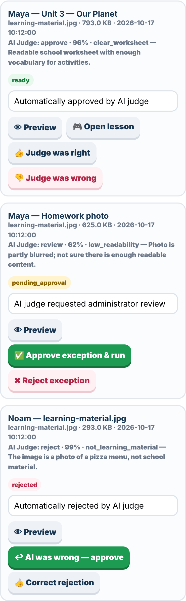
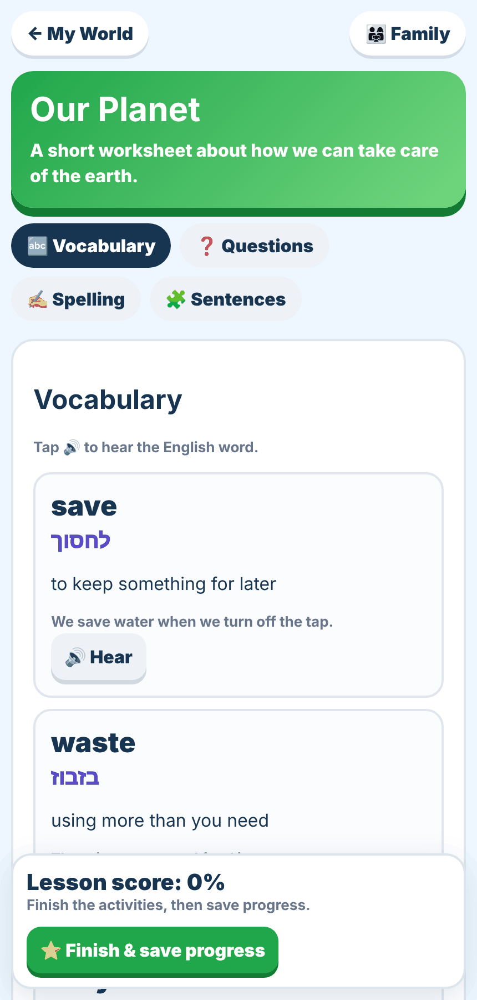
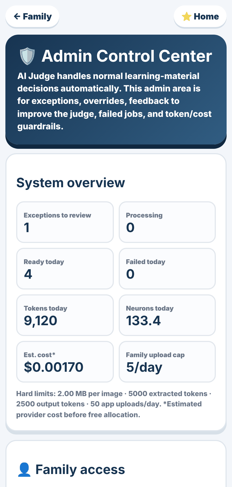
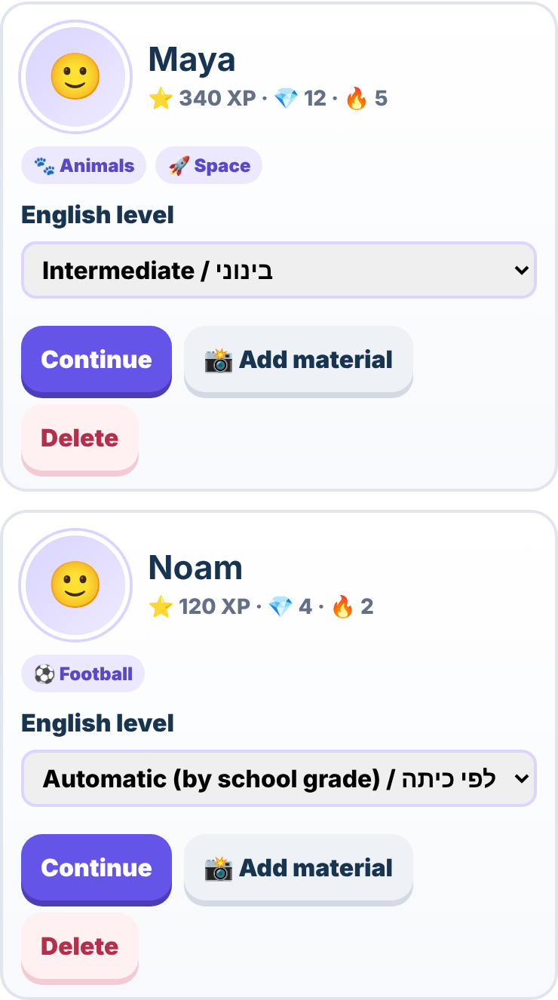
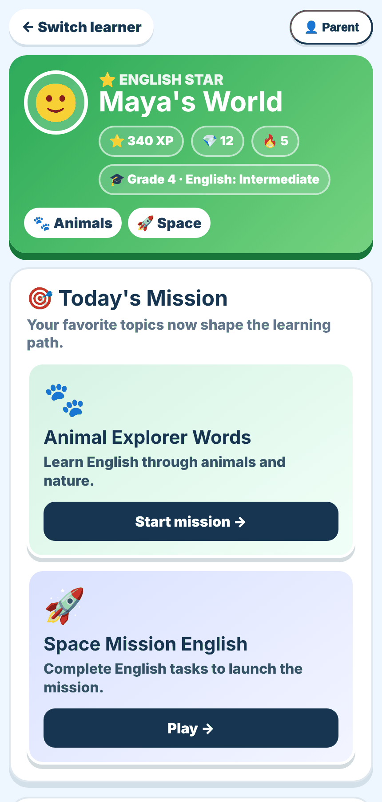
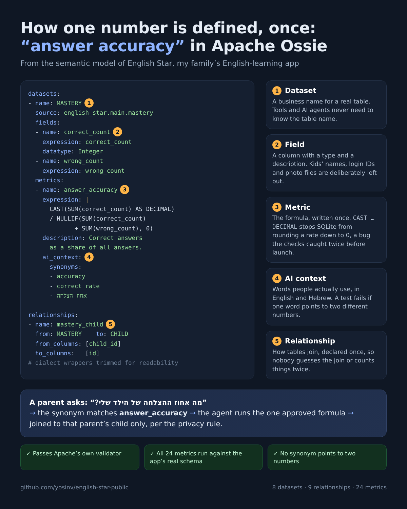
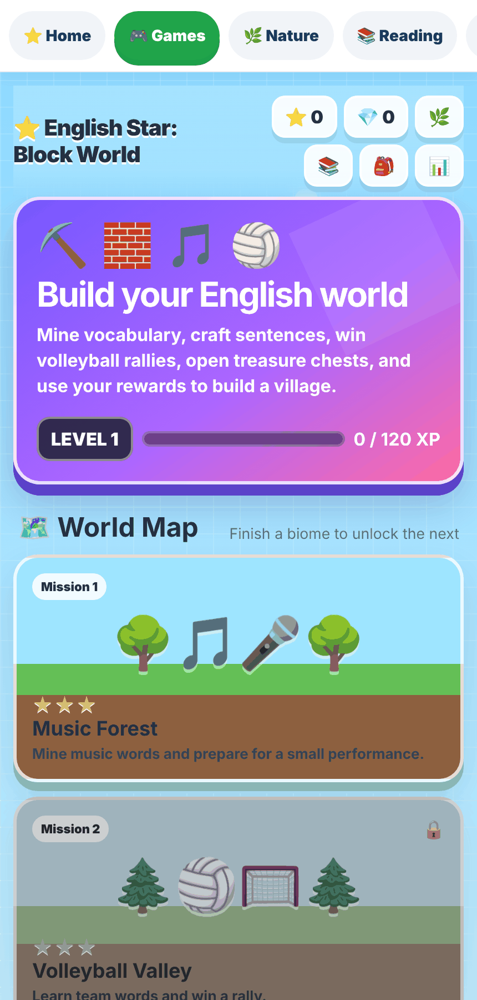
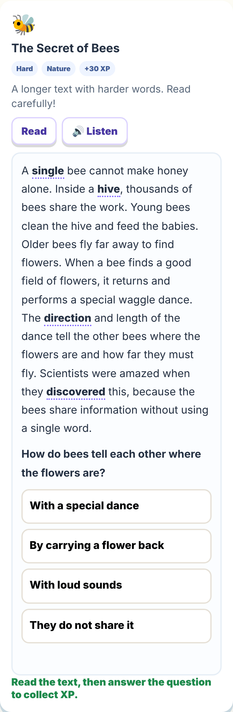
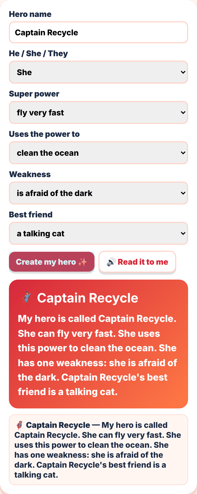
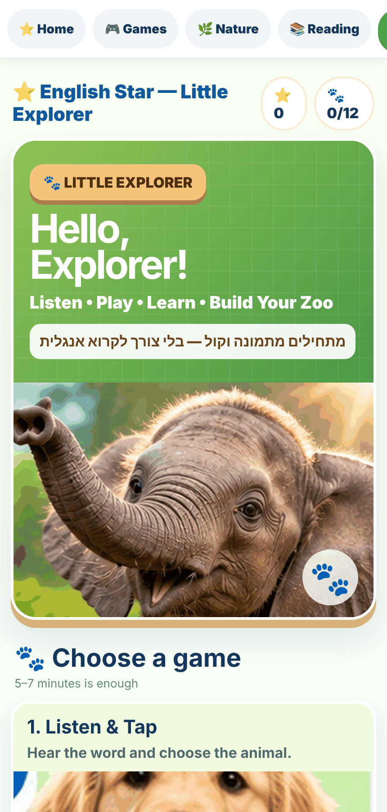

# ⭐ English Star

**An AI-assisted English practice app I built for my family.** Parents photograph a school worksheet, an AI judge decides whether it's worth processing, and an LLM turns it into a personalised lesson (vocabulary, comprehension, spelling, sentence building) matched to the child's English level. Around it sits a set of games for Hebrew-speaking kids learning English.

It runs in production for my family. The repository stays private because it contains my children's school work; this page describes the design.

<p>
  
  
  
</p>

<sub>Screenshots use sample data. Left to right: upload a worksheet and get a lesson, the admin queue of AI judge decisions, the Word Rush game.</sub>

---

## Architecture

| Layer | Choice |
|---|---|
| API and hosting | Cloudflare Workers (Hono), static assets served from the same Worker |
| Data | Cloudflare D1 (SQLite) with versioned migrations |
| Files | Cloudflare R2, private bucket, never publicly addressable |
| AI | Cloudflare Workers AI (Gemma) for extraction, judging and lesson generation |
| Auth | Clerk sign-in for all family and admin APIs |
| Deploy | Push to `main` → Cloudflare build → deploy |

## The upload pipeline

```
photo / PDF
  → type decided from the file's bytes, not the browser's label
  → SHA-256 dedupe (same file twice = no second AI call)
  → atomic quota slot: per family per day + global per day, in one SQL statement
  → private R2 storage
  → text extraction
  → AI judge: approve / reject / send to admin, with confidence thresholds
  → lesson generation, constrained to the child's English level
  → assignment + items saved; the child plays it as a game
```

### AI judge with a human in the loop

Before spending the larger generation budget, a cheap model call decides whether an upload is real learning material.

- **Asymmetric thresholds:** auto-approve needs ≥ 80% confidence, auto-reject needs ≥ 95%. Anything in between goes to an admin queue, so a wrong rejection is rarer than a wrong approval.
- **A fixed rule after the model:** if the judge's own labels say an upload is not school material (a photo of a room, a ceiling, a screen), code rejects it even when the model hedged with "review". Admins must preview a photo before approving it, and any approval can be undone, which also corrects the judge's memory.
- **It learns from corrections:** when the admin overrides or confirms a decision, the case is stored as trusted memory and fed back into the judge's prompt as examples. The latest correction for an upload replaces earlier ones.
- **Untrusted input is treated as data:** text extracted from a photo is wrapped and marked as untrusted, and a judge that flags prompt injection is forced to "review" regardless of its confidence.

<p>
  
  
</p>
<sub>A lesson generated from one worksheet, and the admin dashboard tracking tokens, estimated cost and the hard limits.</sub>

### Cost control that can't be configured away

AI limits (uploads per family per day, uploads per day overall, file size, extracted tokens, output tokens) have **hard ceilings in code**. Environment variables and the admin settings page can tune them, but never above the ceiling. Token usage and estimated cost are recorded per upload and shown on the admin dashboard.

→ Full breakdown of prices, per-upload cost and daily limits: **[AI cost](AI-COSTS.md)**

### Difficulty that actually changes

Each child has an English level (automatic from school grade, or Beginner → Advanced). The level sets the number of words and questions, the question type (direct recall vs. inference), maximum sentence length and spelling word length in the generation prompt. The model's output is then **clamped to the level in code**, so a verbose model can't exceed it.

<p>
  
  
</p>
<sub>Parents set each child's English level; the child's home shows it and builds missions from their interests.</sub>

## One definition per number (Apache Ossie)

Every number the app reports, from XP to AI cost per lesson, is defined once in an **[Apache Ossie](https://github.com/apache/ossie) semantic model**. Ossie is the vendor-neutral standard (formerly Open Semantic Interchange) for defining datasets, joins and metrics so that BI tools and AI agents compute them the same way.

- **[`english_star.semantic_model.yaml`](semantic-model/english_star.semantic_model.yaml)**: 8 datasets, 9 relationships, 24 metrics. Each comes with `ai_context` (meaning, synonyms in English and Hebrew, and a privacy instruction: aggregates or the asking parent's own child only, never names).
- **[`metrics.yaml`](semantic-model/metrics.yaml)**: the short view, generated from the model. One line of meaning, synonyms and formula per number.
- **Verified three ways:**
  - It passes Apache's own validator (schema, references, metric scoping, SQL parsing).
  - **[`check_against_db.py`](semantic-model/check_against_db.py)** runs every metric against SQLite built from the app's real migrations and compares 14 results with hand-computed values.
  - It fails if one synonym points to two different numbers.



**How to read it:** a *dataset* names a real table, *fields* are its columns, a *metric* is a formula written once, `ai_context` holds the words people actually use (so an AI agent asked "מה אחוז ההצלחה?" finds `answer_accuracy`), and *relationships* say how tables join.

**Run the checks yourself** (needs `pyyaml`; [`schema.sql`](semantic-model/schema.sql) is the structure of the 8 tables, no data):

```bash
pip install pyyaml
python semantic-model/check_against_db.py semantic-model/english_star.semantic_model.yaml semantic-model
```

Writing the checks caught real mistakes before anything shipped:
- Two rates that came out as 0 because SQLite divides whole numbers without a fraction.
- "accuracy" used as a synonym for two different metrics.
- A cross-dataset XP total that double-counted under a naive join. The checker now evaluates each measure over its own rows, as Ossie's measure semantics require.

<sub>Structure only, no data. Children's names, login IDs, file keys and photo hashes are deliberately not in the model. The spec is pre-1.0 (`0.2.0.dev0`), so the model will follow its changes.</sub>

## Privacy and security

- **Per-family data boundary:** every child route checks that the child belongs to the signed-in family; all SQL is parameterised.
- **Children's photos are deleted after 14 days** by a scheduled job, with a hard ceiling in code.
- **Private pages for my own kids** are served through the Worker and only to the owner account.
- **Admin controls:** freeze an account (checked server-side, fails closed), override the judge, full audit log of admin actions.
- Hardened after a self-review: static files served only from `public/`, security headers, stored-XSS fix on AI-generated titles, server-side XP.

## The games

Built for 9–10-year-olds, designed so guessing doesn't win: shuffled answers with plausible distractors, two tries before the answer is shown, and XP only for first- or second-try answers.

- **Word Rush:** 60-second vocabulary race across four levels, with combos and personal bests
- **Nature Explorer:** animal stories plus riddles, true/false, vocabulary and spelling games built from them
- **Reading library:** Easy / Medium / Hard texts, where XP requires answering a comprehension question
- **Hero English:** superhero-themed reading and a "make your own hero" sentence builder
- **School work:** written Hebrew-meaning tests and fill-the-gap practice for a child's actual vocabulary list

<table>
  <tr>
    <td></td>
    <td></td>
    <td></td>
  </tr>
  <tr>
    <td align="center"><sub>Block World missions</sub></td>
    <td align="center"><sub>Hard reading + question</sub></td>
    <td align="center"><sub>Nature games</sub></td>
  </tr>
  <tr>
    <td></td>
    <td></td>
    <td></td>
  </tr>
  <tr>
    <td align="center"><sub>Make your own hero</sub></td>
    <td align="center"><sub>Little Explorer for young kids</sub></td>
    <td align="center"><sub>Word Rush</sub></td>
  </tr>
</table>

---

[← Yosi Navaro on GitHub](https://github.com/yosinv)
