# ⭐ English Star Kids

**A free English-learning web app for Hebrew-speaking children in grades 1–6.** Kids learn through games: English basics, grammar, reading, nature stories, word races and a pet they look after in English. Parents can photograph a school worksheet, an AI judge decides whether it's real learning material, and AI turns it into a lesson matched to the child's English level.

**Live at [englishstarkids.com](https://englishstarkids.com)**, open to any family. It started as an app for my own kids; the code repository stays private because it holds their school work, so this page describes the design.

<p>
  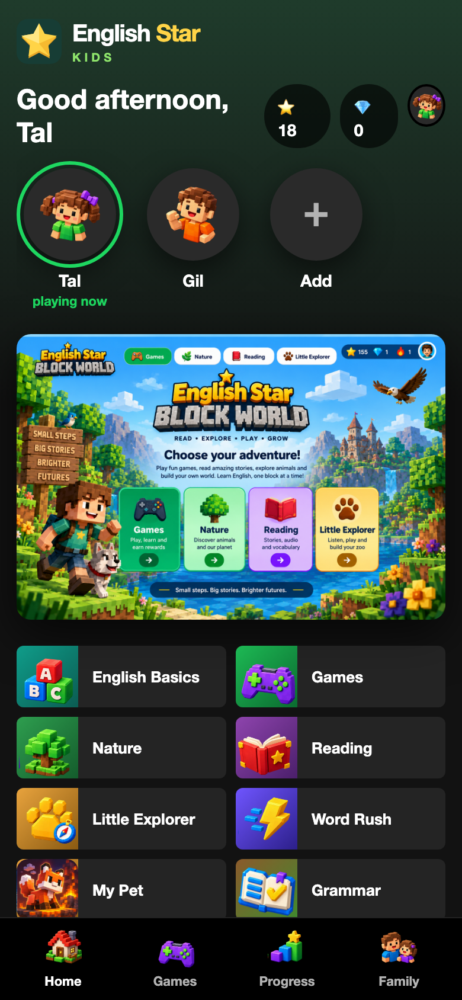
  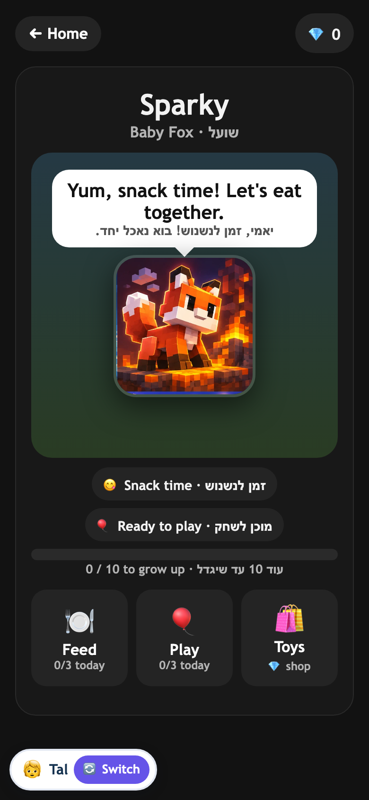
  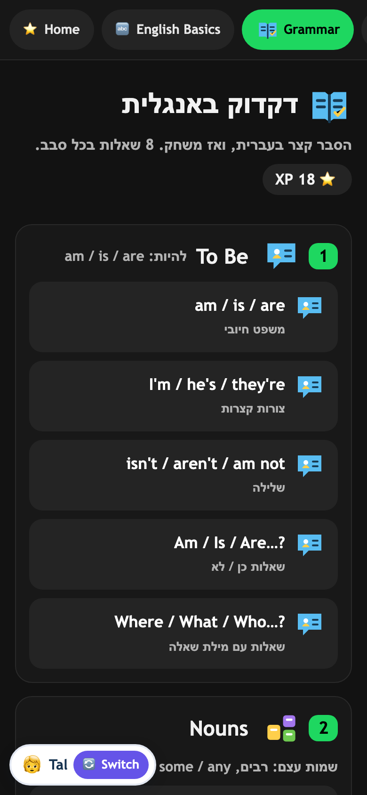
</p>

<sub>Screenshots use sample data (test kids, not real children). Left to right: the home page, My Pet, the Grammar world.</sub>

---

## Architecture

| Layer | Choice |
|---|---|
| API and hosting | Cloudflare Workers (Hono), static assets served from the same Worker |
| Data | Cloudflare D1 (SQLite) with versioned migrations |
| Files | Cloudflare R2, private bucket, never publicly addressable |
| AI | Cloudflare Workers AI (Gemma 4, `gemma-4-26b-a4b-it`) for reading photos, judging and lesson generation |
| Auth | Clerk sign-in (email code or password) for families; a parent PIN guards parent actions; kid phones connect with a one-time code |
| Voices | Free recorded voices (open-source Kokoro), made once and served as files; paid voice off by default |
| Deploy | Push to `main` → Cloudflare build → deploy |

## The upload pipeline

```
photo / PDF
  → type decided from the file's bytes, not the browser's label
  → SHA-256 dedupe (same file twice = no second AI call;
                     a file the judge refused before is checked again)
  → atomic quota slot: per family per day + global per day, in one SQL statement
  → private R2 storage
  → text extraction
  → AI judge: approve / reject / send to admin, with confidence thresholds
  → lesson generation, constrained to the child's English level
  → assignment + items saved; the child plays it as a game
```

### AI judge with a human in the loop

<p>
  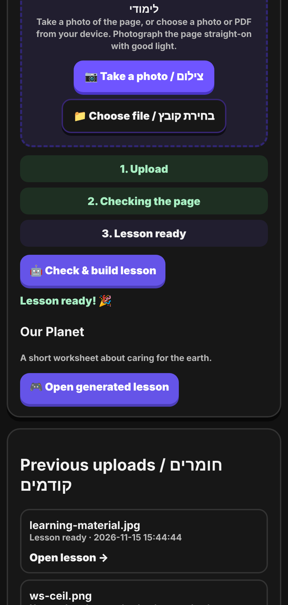
  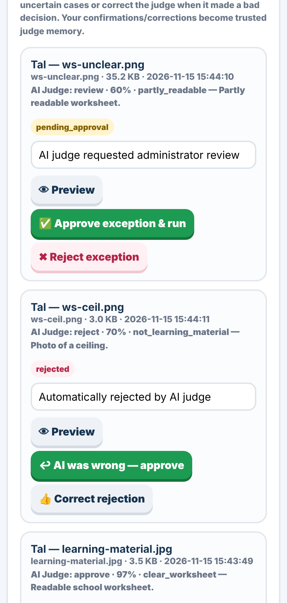
</p>
<sub>Upload a worksheet and get a lesson; the admin queue of AI judge decisions.</sub>

Before spending the larger generation budget, a cheap model call decides whether an upload is real learning material.

- **Asymmetric thresholds:** auto-approve needs ≥ 80% confidence, auto-reject needs ≥ 95%. Anything in between goes to an admin queue, so a wrong rejection is rarer than a wrong approval.
- **A fixed rule after the model:** if the judge's own labels say an upload is not school material (a photo of a room, a ceiling, a screen), code rejects it even when the model hedged with "review". Admins must preview a photo before approving it, and any approval can be undone, which also corrects the judge's memory.
- **It learns from corrections:** when the admin overrides or confirms a decision, the case is stored as trusted memory and fed back into the judge's prompt as examples. The latest correction for an upload replaces earlier ones.
- **The admin hears about it:** when an upload lands in the review queue, the admin can get a short email (no child names or pictures in it; the details stay on the admin page).
- **Untrusted input is treated as data:** text extracted from a photo is wrapped and marked as untrusted, and a judge that flags prompt injection is forced to "review" regardless of its confidence.

<p>
  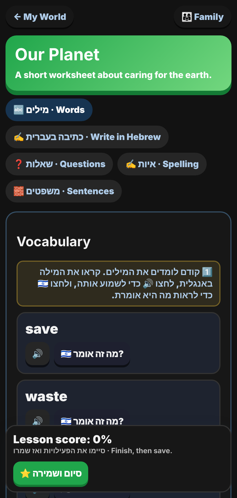
  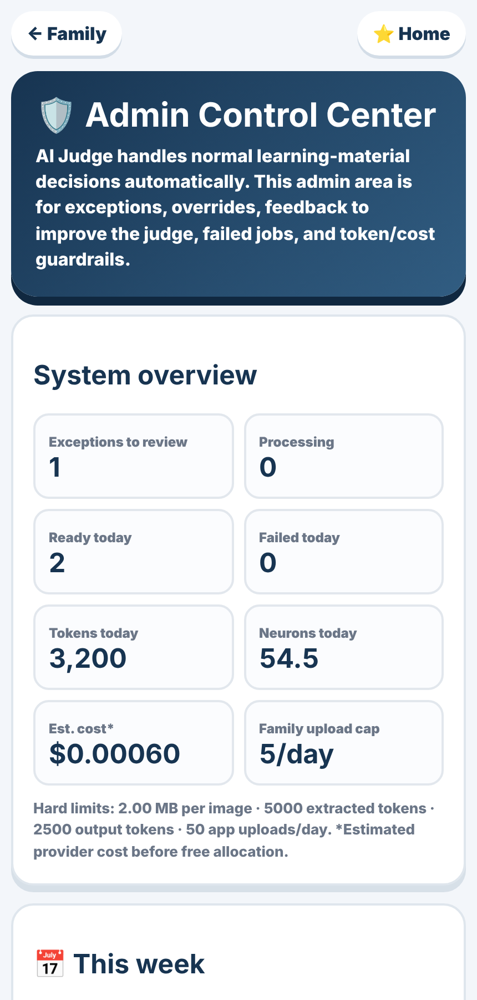
</p>
<sub>A lesson generated from one worksheet, and the admin dashboard tracking tokens, estimated cost and the hard limits.</sub>

### Cost control that can't be configured away

AI limits (uploads per family per day, uploads per day overall, file size, extracted tokens, output tokens) have **hard ceilings in code**. Environment variables and the admin settings page can tune them, but never above the ceiling. Token usage and estimated cost are recorded per upload and shown on the admin dashboard.

→ Full breakdown of prices, per-upload cost and daily limits: **[AI cost](AI-COSTS.md)**

### Difficulty that actually changes

Each child has an English level (automatic from school grade, or Beginner → Advanced). The level sets the number of words and questions, the question type (direct recall vs. inference), maximum sentence length and spelling word length in the generation prompt. The AI's output is then **clamped to the level in code**, so a wordy answer can't exceed it.

<p>
  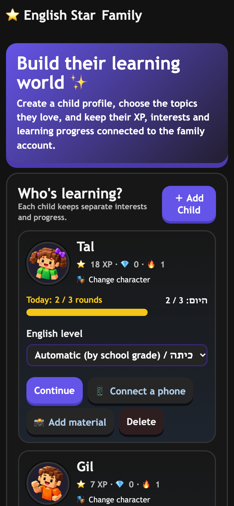
  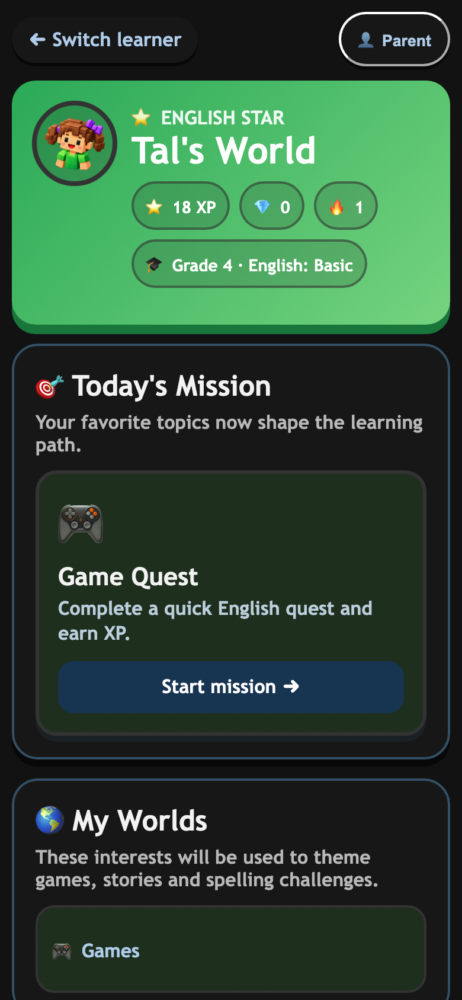
</p>
<sub>Parents set each child's English level and see today's practice (goal: 3 rounds a day); the child's home shows the level and builds missions from their interests.</sub>

## AI around the app, not only inside it

- **Open to AI assistants.** Public pages are open to search engines and AI crawlers ([`robots.txt`](https://englishstarkids.com/robots.txt)), carry structured data, and the site has an [`llms.txt`](https://englishstarkids.com/llms.txt) that tells AI assistants what it offers. Private pages (family, progress, uploads, admin) are closed to them and marked noindex.
- **Pages people search for.** 11 word-list pages (colors, numbers, months…) and 23 grammar pages, one per lesson, each with the rule, examples and a link to practise it as a game.
- **Lessons from school email.** A parent can paste a file link from the school's email system and it goes through the same upload pipeline.

<p>
  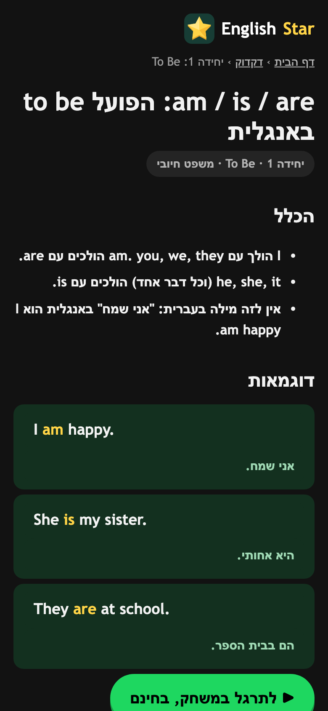
  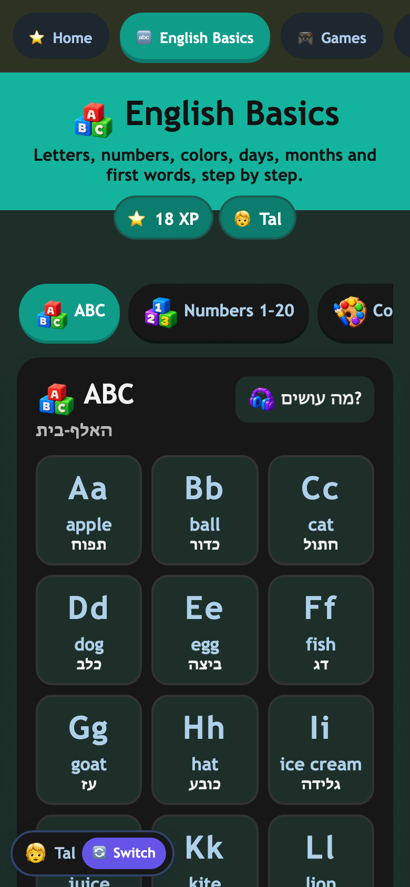
</p>
<sub>A public grammar page made for Google and AI assistants, and English Basics (11 topics, each with a "Write it" spelling mode).</sub>

## Built with Claude Code

I build English Star with AI coding agents ([Claude Code](https://claude.com/claude-code)) and run them like a small team with rules:

- **A written project guide** (`CLAUDE.md`) in the repo: the stack, the privacy rules, the decisions on record, and how I want work done. Every session starts from it.
- **Nothing goes live without me.** Each change is built on a branch, tested on a local copy of the whole app (real worker code, local database, fake sign-in and a fake AI), shown to me as phone-size screenshots, and merged only after my OK. Merging to `main` is going live.
- **Privacy rules the agent must follow.** Tests and screenshots use made-up kids, never my children's names or school material; no secret keys in chat; photos of children are never profile pictures.
- **Two agents, one repo.** One session works on design and icons while another works on features, so each one fetches the latest `main` and checks it isn't overwriting the other's work before merging.
- **Every update ends with a "Still waiting" list:** what was suggested but not built, and what waits for my approval. Notes and the to-do list live in my notes app, so work can continue from my phone.

## One definition per number (Apache Ossie)

Every number the app reports, from XP to AI cost per lesson, is defined once in an **[Apache Ossie](https://github.com/apache/ossie) semantic model**. Ossie is the vendor-neutral standard (formerly Open Semantic Interchange) for defining datasets, joins and metrics so that BI tools and AI agents compute them the same way.

- **[`english_star.semantic_model.yaml`](semantic-model/english_star.semantic_model.yaml)**: 8 datasets, 9 relationships, 24 metrics. Each comes with `ai_context` (meaning, synonyms in English and Hebrew, and a privacy instruction: aggregates or the asking parent's own child only, never names).
- **[`metrics.yaml`](semantic-model/metrics.yaml)**: the short view, generated from the model. One line of meaning, synonyms and formula per number.
- **Verified three ways:**
  - It passes Apache's own validator (schema, references, metric scoping, SQL parsing).
  - **[`check_against_db.py`](semantic-model/check_against_db.py)** runs every metric against SQLite built from the app's real migrations and compares 14 results with hand-computed values.
  - It fails if one synonym points to two different numbers.

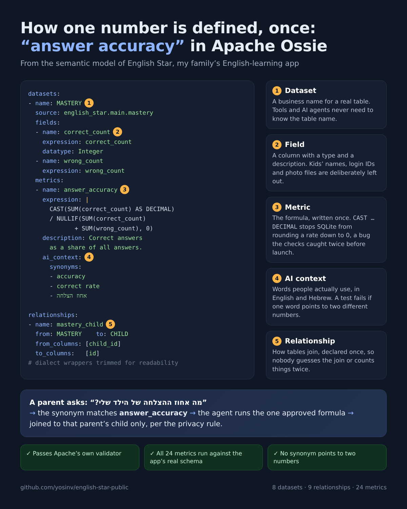

**How to read it:** a *dataset* names a real table, *fields* are its columns, a *metric* is a formula written once, `ai_context` holds the words people actually use (so an AI agent asked in Hebrew for the "success rate" finds `answer_accuracy`), and *relationships* say how tables join.

**Run the checks yourself** with [uv](https://docs.astral.sh/uv/) ([`schema.sql`](semantic-model/schema.sql) is the structure of the 8 tables, no data):

```bash
uv run --with pyyaml semantic-model/check_against_db.py semantic-model/english_star.semantic_model.yaml semantic-model
```

Writing the checks caught real mistakes before anything shipped:
- Two rates that came out as 0 because SQLite divides whole numbers without a fraction.
- "accuracy" used as a synonym for two different metrics.

And one in my own checker, not the model: a cross-dataset XP total double-counted under a naive join. The checker now evaluates each measure over its own rows, as Ossie's measure semantics require.

<sub>Structure only, no data. Children's names, login IDs, file keys and photo hashes are deliberately not in the model. The spec is pre-1.0 (`0.2.0.dev0`), so the model will follow its changes.</sub>

## Privacy and security

- **Per-family data boundary:** every child route checks that the child belongs to the signed-in family; all SQL is parameterised.
- **Children's photos are deleted after 14 days** by a scheduled job, with a hard ceiling in code.
- **Private pages for my own kids** are served through the Worker and only to the owner account.
- **Kid phones without a password:** a parent shows a 6-digit code (10 minutes, one use); the phone then acts as that one child only, with no parent actions, other kids or admin. Wrong codes are rate-limited, and the parent can disconnect phones.
- **Characters, not photos:** profile pictures are drawn characters or emoji, never photos of children.
- **Account delete** removes the family's data, and a privacy page explains what is kept and for how long.
- **Admin controls:** freeze an account (checked server-side, fails closed), override the judge, full audit log of admin actions.
- Hardened after a self-review: static files served only from `public/`, security headers, stored-XSS fix on AI-generated titles, server-side XP.

## The games

Built for grades 1–6 and designed so guessing doesn't win: shuffled answers with plausible distractors, two tries before the answer is shown, and XP only for first- or second-try answers. Every lesson section ends with a quick check; finishing checks earns spins on a prize wheel, whose diamonds buy toys for the child's pet.

- **English Basics:** 11 topics (ABC, numbers, colors, days, months…), each with a "Write it" mode: type or tap the letters
- **Grammar:** units 1–5, 23 lessons, each a short explanation in Hebrew and then a game
- **My Pet:** each child hatches a pet, feeds it and plays with it in English (3 meals and 3 games a day), and it grows with care
- **Word Rush:** 60-second vocabulary race across four levels, with combos and personal bests
- **Block World:** mine vocabulary and craft sentences, then spend rewards building a village
- **Nature Explorer:** animal stories plus riddles, true/false, vocabulary and spelling games built from them
- **Reading library:** Easy / Medium / Hard texts, where XP requires answering a comprehension question
- **Hero English:** superhero-themed reading and a "make your own hero" sentence builder
- **Little Explorer:** listen-and-tap games for the youngest

<table>
  <tr>
    <td>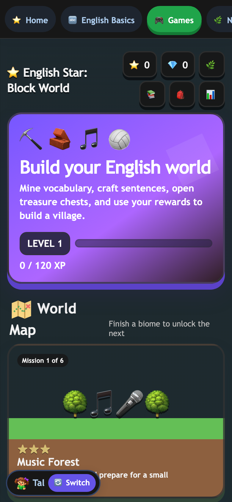</td>
    <td>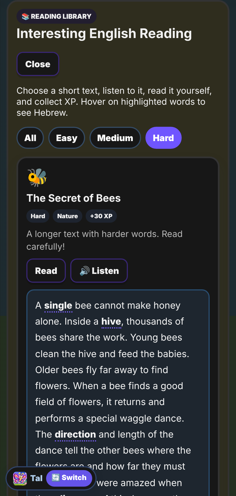</td>
    <td>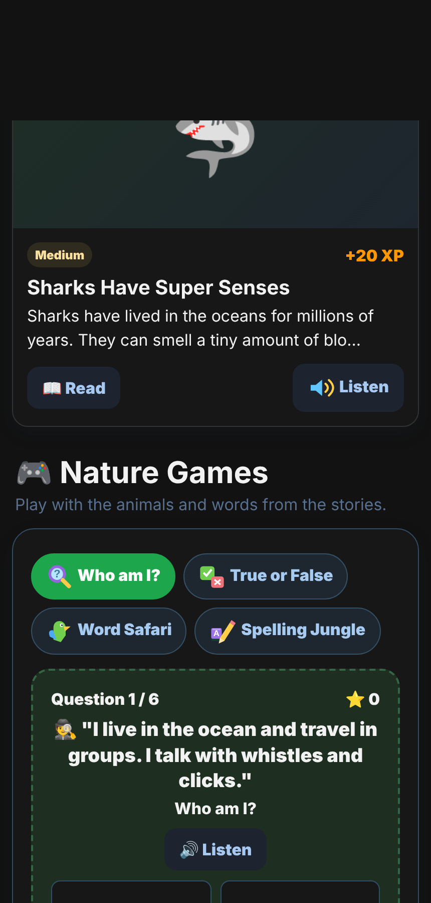</td>
  </tr>
  <tr>
    <td align="center"><sub>Block World</sub></td>
    <td align="center"><sub>Hard reading + question</sub></td>
    <td align="center"><sub>Nature games</sub></td>
  </tr>
  <tr>
    <td>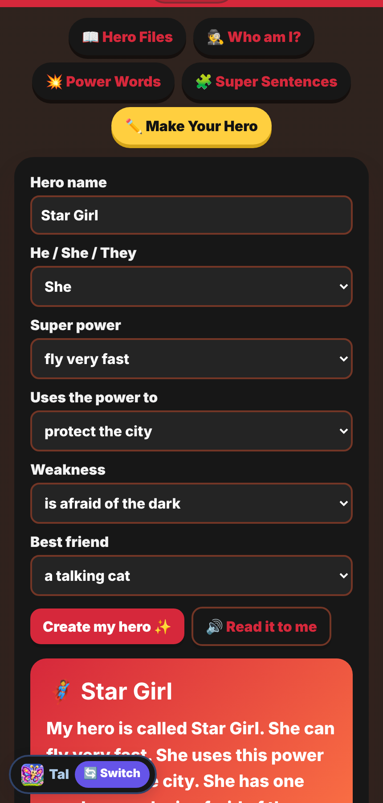</td>
    <td>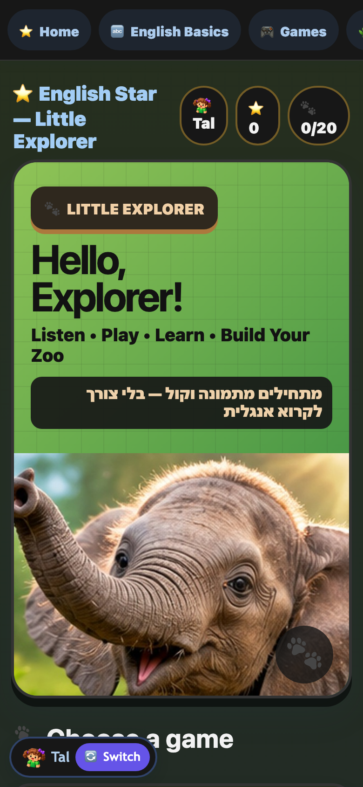</td>
    <td>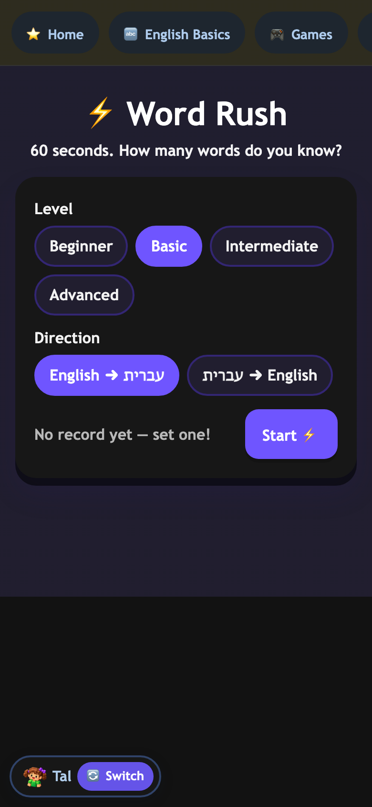</td>
  </tr>
  <tr>
    <td align="center"><sub>Make your own hero</sub></td>
    <td align="center"><sub>Little Explorer for young kids</sub></td>
    <td align="center"><sub>Word Rush</sub></td>
  </tr>
</table>

---

[← Yosi Navaro on GitHub](https://github.com/yosinv)
